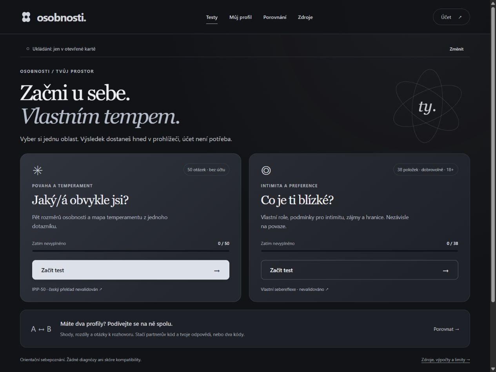
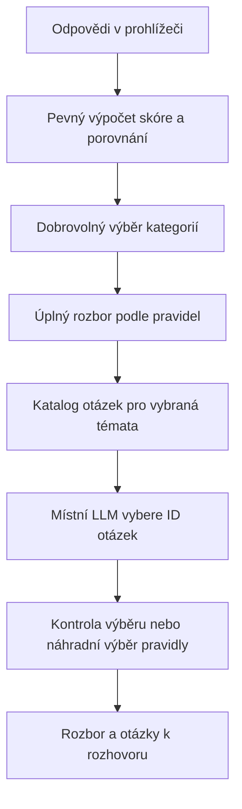

# Osobnosti

Česká webová aplikace pro poznávání vlastních odpovědí, osobnostních rysů a dobrovolných intimních preferencí. Umožňuje porovnat dva profily, rozebrat jejich shody i rozdíly a připravit otázky pro společný rozhovor.

**[Otevřít běžící web → opicebot.cz/osobnosti_test](https://opicebot.cz/osobnosti_test/)**



## Co web umí

- **Osobnost:** 50 položek IPIP pro pět širokých rysů Big Five, průběžné vyplňování a přehledné výsledky.
- **Temperament:** orientační pohled na historické názvy jako cholerik, sangvinik, melancholik a flegmatik.
- **Intimita pro dospělé:** dobrovolný přehled rolí, podmínek pro blízkost a neexplicitních preferencí aktivit. Jednotlivé otázky lze přeskočit.
- **Porovnání:** dva sdílecí kódy nebo jeden partnerův kód a vlastní místní profil. Výběr kategorií je na uživateli.
- **Rozbor:** vysvětlení všech dostupných témat, společných bodů, rozdílů, nejasností a hranic; konkrétní otázky k rozhovoru.
- **Osobní AI rozbor:** dobrovolný souvislý výklad vlastních výsledků s hypotetickými příklady, malým krokem k ověření a otázkami, kdy výklad sedí i nesedí. Přístupný z Mého profilu i výsledků.
- **Uložení po obou testech:** na účet s nicknamem a heslem, do tohoto zařízení, nebo pouze do relace. Každý test má vlastní volbu. Uložené výsledky jsou kdykoliv dostupné z účtu, i na jiném zařízení; lze vytvořit kód pro párové porovnávání.
- **Sdílení:** zvolené části výsledku přes odvolatelný kód s platností 7 dní; karty PNG ke stažení do telefonu.
- **Soukromí:** možnost smazat místní profil, uložený výsledek, sdílecí kód nebo celý účet.

Rozhraní je v češtině, v tmavém režimu a přizpůsobené telefonu. Zdrojové podklady, výpočty a omezení mají vlastní sekce přímo v aplikaci.

## Co výsledky znamenají

**Jde o nástroj pro sebereflexi, nikoli o validovaný psychologický test či předpověď vztahu.**

| Oblast | Na čem stojí | Co z ní nelze vyvozovat |
| --- | --- | --- |
| Big Five | Původní anglické položky IPIP-50 a zveřejněný skórovací klíč; vlastní český překlad | Český překlad není validovaný, nemá populační normy ani odbornou revizi. Průměr 1–5 není percentil. |
| Temperament | Vlastní ilustrativní mapa extraverze a emoční stability | Historické typy nejsou další nezávislý test ani pevná osobnostní diagnóza. |
| Intimita | 38 vlastních položek: 16 k rolím, 12 ke kontextu a 10 k aktivitám | Nejde o validovanou škálu, diagnózu, předpověď chování ani určení toho, co má člověk dělat. |
| Porovnání | Stejné škály a výslovně zpřístupněné odpovědi obou lidí | Shoda nezaručuje spokojenost; rozdíl není porucha. Aplikace nepočítá procento partnerské kompatibility. |

„Možná / chci probrat“ není potvrzený zájem. „Nevím“, vynechaná odpověď a „nechci“ se nerozšiřují na souhlas. Ani společný zájem není souhlas s konkrétní situací. Zájem o vlastní roli automaticky neurčuje preferovanou roli partnera.

## Jak je zapojená AI

AI byla použita při vývoji aplikace, tvorbě vlastního českého překladu a textů. To nenahrazuje psychometrickou validaci ani revizi psychologem.

**AI má dvě oddělené role.** V partnerském porovnání vybírá otázky z připraveného katalogu. V osobním rozboru píše podmíněný výklad zvolených výsledků. Výpočet skóre vždy zůstává v pevných pravidlech.

### Osobní rozbor

Uživatel zvolí kategorie v [Osobním rozboru](https://opicebot.cz/osobnosti_test/#rozbor). Výchozí je pouze osobnost. `personal-input.mjs` vybere podporované hodnoty, verze a připravené popisy. Model nedostává identity, přístupové kódy, původní jednotlivé položky IPIP ani nevybrané kategorie. Preference aktivit, hranice a neurčené odpovědi vysvětluje prohlížeč podle pravidel mimo model.

`personal-analysis.mjs` požádá místní model o samostatnou kapitolu pro každou vybranou číselnou oblast: hypotetickou situaci, možnost pozorování, možné tření a dvě otázky pro ověření i zpochybnění výkladu. Význam jednotlivých odpovědí sestaví pevná pravidla a zobrazí jej před AI částí. Přesná čísla jsou oddělená v rozbalitelných podkladech. Kontrolujeme strukturu, povolené kapitoly, délku, podmíněné formulace a některé nepřípustné výrazy. **Tyto kontroly nejsou ověřením pravdivosti ani psychologické platnosti.** Model se může mýlit i při správném formátu; tato funkce nemá výzkumnou validaci.

Člověk může kapitoly označit „Sedí / Někdy / Nesedí“. Toto hodnocení nemění skóre ani nedokazuje přesnost. Rozbor i zpětná vazba zůstávají pouze v paměti otevřené karty; změna odpovědí či kategorií, smazání, odhlášení nebo obnovení stránky je odstraní. Při výpadku nebo odmítnutém výstupu zůstávají dostupné původní výsledky a otázky podle pravidel. [Zdroje a limity osobního rozboru →](https://opicebot.cz/osobnosti_test/#podklady-rozbor)

### Partnerské porovnání

1. Prohlížeč spočítá skóre podle pevného klíče. Porovnání zachová označení profilů A a B i přesné druhy odpovědí.
2. Uživatel vybere kategorie pro rozbor. Pro tuto akci se na aplikační server odešlou jen vybrané podklady; přihlašovací klíče, sdílecí kódy a nevybrané kategorie se modelu neposílají.
3. `analysis-core.mjs` sestaví úplný rozbor podle pravidel. Zahrne shody, rozdíly i význam nejasných odpovědí. Výklad hranic a neurčených preferencí zůstává mimo model.
4. `ai-explanation.mjs` předloží místnímu modelu skupiny připravených otázek. Model vrací pouze identifikátory `group` a `topicId`.
5. Odpověď projde kontrolou schématu, příslušnosti ke skupinám a duplicit. Znění vybraných otázek se načte z katalogu; volný text modelu se nezobrazuje.
6. Když model není dostupný nebo vrátí neplatný výběr, otázky vyberou pravidla a celý rozbor zůstane zachovaný. Při výpadku samotné služby rozboru funguje dál běžné porovnání.

Model může běžet například přes **llama.cpp** s místním API kompatibilním s OpenAI. Kompatibilita protokolu neznamená použití služby OpenAI. Repozitář neobsahuje modelové váhy ani cloudový API klíč.



Porovnání nerozhoduje o kompatibilitě, neurčuje diagnózu a neodvozuje souhlas či nevyplněné preference. Výběr otázky není odborné hodnocení její důležitosti pro vztah.

## Spuštění

Pro samotné dotazníky, výsledky a exporty stačí Node.js 22 nebo novější:

```sh
npm start
```

Otevři **http://127.0.0.1:4175**. Nejsou potřeba externí balíčky ani sestavení. Tento statický náhled nespouští PHP účty, načítání sdílených profilů ani serverový rozbor.

Plná verze používá HTTPS webserver, PHP se SQLite a Sodium a volitelně Node.js službu pro rozbor. Konfigurace, vytvoření databáze a místní model jsou popsány v **[návodu k nasazení](docs/DEPLOYMENT.md)**.

## Struktura a testy

| Cesta | Úloha |
| --- | --- |
| `dist/` | Hotové veřejné soubory webu, dotazníky, skórování, UI a PHP API |
| `analysis-core.mjs` | Pravidla pro vysvětlení shod, rozdílů a hranic |
| `ai-explanation.mjs` | Příprava výběru otázek, volání modelu a validace odpovědi |
| `personal-analysis.mjs` | Osobní AI výklad, strukturovaný výstup a kontroly formátu |
| `dist/personal-input.mjs`, `dist/personal.mjs` | Výběr podkladů, osobní rozbor a dočasná zpětná vazba |
| `ai-service.mjs` | Místní HTTP služba rozboru, dostupná pouze přes loopback |
| `server/` | Vytvoření soukromé databáze a generování schématu položek |
| `tests/` | Syntetické testy skórování, porovnání, soukromí, AI a API |

```sh
npm test
python3 tests/api_integration.py
```

Druhý příkaz vyžaduje PHP rozšíření popsaná v návodu a prostředí podporující symbolické odkazy. Používá dočasnou databázi a místní server; nepracuje s produkčními profily. Testy nenahrazují validaci dotazníku ani nezávislý bezpečnostní audit.

## Data a soukromí

Dlouhodobé zapamatování v prohlížeči je volitelné a výchozí vypnuté. Rozpracované odpovědi se uchovávají v `sessionStorage` aktuální karty a přežijí obnovení stránky. Obnovení zavřených karet může obnovit i relaci; explicitní smazání ji odstraní. `localStorage` obsahuje odpovědi, není šifrované aplikací a je dostupné lidem s přístupem ke stejnému profilu prohlížeče. Neslouží jako záloha.

Uložení na server je samostatná volba. Databáze je mimo veřejný adresář; odpovědi jsou šifrované serverovým klíčem, hesla používají Argon2id (64 MiB, 3 průchody, 1 vlákno), náhodná přihlašovací a sdílecí tajemství se ukládají jako hashe. Nickname je unikátní bez ohledu na velikost písmen. Obnova zapomenutého hesla není podporovaná. Volitelné zapamatování přihlášení na 30 dní používá samostatný odvolatelný token; krátká relace trvá 12 hodin. Starší účty lze převést z ID a klíče bez ztráty uložených výsledků. Správce serveru má technickou možnost data číst — nejde o koncové šifrování. Celý sdílecí kód umožňuje načíst zvolené kategorie až do zrušení nebo vypršení.

Tento repozitář obsahuje zdrojový kód, dokumentaci a syntetické testovací podklady. Neobsahuje databázi uživatelů, skutečné profily, přístupové klíče, provozní logy, soukromou konfiguraci ani interní síťové adresy. Provozovatel vlastní instance odpovídá za nastavení serveru, přístupová oprávnění, zálohy a pravdivost informací o zpracování dat.

## Podklady

- [IPIP: původních 50 položek](https://www.ipip.ori.org/New_IPIP-50-item-scale.htm)
- [IPIP: skórovací klíč](https://www.ipip.ori.org/newBigFive5broadKey.htm) a [pravidla skórování](https://www.ipip.ori.org/newScoringInstructions.htm)
- [IPIP: podmínky použití a překladu](https://www.ipip.ori.org/newPermission.htm)
- [IPIP: interpretace individuálních skóre](https://ipip.ori.org/InterpretingIndividualIPIPScaleScores.htm)
- [Zdroje a omezení přímo v běžící aplikaci](https://opicebot.cz/osobnosti_test/#podklady)
- [Podklady porovnání](https://opicebot.cz/osobnosti_test/#podklady-porovnani)

Publikovaná česká adaptace IPIP-BFM-50 není v projektu reprodukována. Její výsledky validace nelze přenášet na vlastní české znění použité zde. Podrobnější rozlišení převzatého základu a vlastní práce je v [NOTICE.md](NOTICE.md).

### Vysvětlivky k otázkám

U všech 50 výroků IPIP a 38 intimních položek lze tlačítkem „i Vysvětlení“ otevřít vlastní vysvětlení běžnými slovy. Například rozlišuje „málokdy“ a „často“ u sklíčenosti, zájem a schopnost u abstraktních myšlenek či nejistotu, zájem a souhlas u intimních témat. Ovládání funguje dotykem i klávesnicí pomocí nativního `details/summary`.

Texty v `dist/question-help.mjs` jsou redakční pomůcka vytvořená s pomocí AI, ne oficiální výklad IPIP, odborná revize nebo validovaná součást nástroje. Příklady pouze přibližují význam; původní položky, jejich verze, odpovědi a skórování se nemění. Vliv vysvětlivek na odpovědi není ověřen. Rozbalení se samostatně nezaznamenává ani neodesílá; vše je dostupné i v místním náhledu bez AI služby.

Odpovědi v obou dotaznících používají celé popisky „Vůbec mě nevystihuje“ až „Velmi mě vystihuje“, aby zkrácené „ne/ano“ neměnilo význam záporných vět. U 12 osobnostních položek je navíc trvale viditelný význam obou konců stupnice. Tyto redakční pomůcky v `dist/answer-direction.mjs` se určují podle znění konkrétní otázky, nikdy automaticky podle příznaku obráceného skórování. Na mobilu jsou odpovědi v čitelných řádcích. Původní hodnoty, výpočet a uložené výsledky se nemění.
